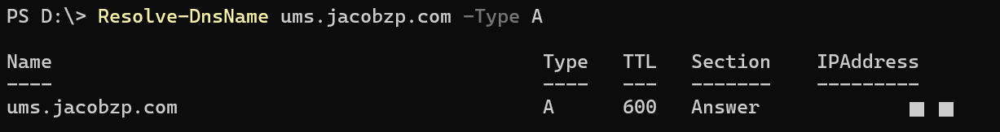

# 用户中心

该项目本质上是 `用户管理系统`。

通过该项目也希望能够轻易做出一个管理系统。

## 需求分析

1. 登录 / 注册
2. 用户管理（仅管理员可见）
3. 用户校验（不一定需要）


## 设计


## 技术选型

这个部分是比较难的，如果是在企业的技术选型需要各方面的考察。我的理解是需要考虑到技术的 **难度**、**熟悉度**、**适配性**、**社区活跃度** 等等。

但是这是一个个人项目，最好就选择自己最熟悉的就可以。

### 前端

- 三件套
- React
- 组件库 Ant Design / Ant Design Pro（现成的管理系统）
- Umi

### 后端

- Java
- Spring （依赖注入框架，帮忙管理 Java 对象，还有相关的一些集成）
- SpringBoot（不用自己管理 spring 配置，不用自己整合各种框架和库，可以快速启动和集成）
- SpringMVC（Web 框架，提供接口访问、Restful 接口等能力）
- Mybatis（数据库操作/持久层 框架，对 jdbc 的封装）
- Mybatis-Plus（对 mybatis 的增强，不用写 sql 也能实现增删改查）
- Mysql（关系型数据库）
- Java 第三方库：
  - `Lombok`：样板代码生成库(get、set)
  - `Junit`：单元测试库
  - `knife4j`：Swagger 的“增强包”，用于生成“接口文档”


### 部署

公网部署使用 Nginx、systemd 和 MySQL，具体步骤见下文「部署」。


## 项目初始化

### 前端初始化

前端位于 `ums-frontend`，基于 Ant Design Pro 官方精简模板。建议使用 Node.js 22.22.1 或更新版本及 `npm`。

```powershell
cd ums-frontend
npm install
npm start
```

浏览器打开 [用户中心](http://localhost:8000)。`npm start` 默认连接真实后端，Umi 将同源的 `/api` 请求保留原路径转发至 `http://localhost:8080`。如后端使用其他端口，在启动前端的 PowerShell 会话中设置 `$env:UMS_BACKEND_URL = "http://localhost:8081"`。

运行 `npm run build` 可构建根路径版本。公网版本通过 `UMS_BASE_PATH=/ums/` 构建，使用同源的 `/ums/api/`。构建参数和 Nginx 配置见下文「部署」。


### 后端初始化

后端位于 `ums-backend`，使用 Java 21、Maven 3.9、Spring Boot 4.0.10 和 MyBatis-Plus 3.5.18。Spring、Spring MVC、MyBatis、JUnit 和 MySQL JDBC 驱动的兼容版本由 Spring Boot 或 MyBatis-Plus 管理。本机可使用已有的 MySQL 8.0 服务。

先使用已有 MySQL 管理账号创建数据库，并为应用准备有该库访问权限的账号：

```sql
CREATE DATABASE IF NOT EXISTS ums CHARACTER SET utf8mb4 COLLATE utf8mb4_unicode_ci;
```

选择 `ums` 数据库并执行 [用户建表脚本](ums-backend/src/main/resources/sql/user.sql)。在后端启动后通过注册页创建首个账号，再按下文「用户管理」的 SQL 将该账号提升为管理员。

在项目根目录用 PowerShell 启动后端。凭据提示使用本地 MySQL 应用账号。Maven 和 Java 从环境变量读取密码，退出后清除当前 PowerShell 会话中的 `DB_PASSWORD`。

```powershell
$env:DB_HOST = "localhost"       # 默认 localhost
$env:DB_PORT = "3306"            # 默认 3306
$env:DB_NAME = "ums"              # 默认 ums
$umsDbCredential = Get-Credential -Message "请输入本地 MySQL 应用账号和密码"
# $env:SERVER_PORT = "8081"      # 默认 8080，端口被占用时可修改
try {
    if (!$umsDbCredential -or [string]::IsNullOrWhiteSpace($umsDbCredential.UserName) -or !$umsDbCredential.Password.Length) {
        throw '请输入本地 MySQL 应用账号和密码。'
    }
    $env:DB_USERNAME = $umsDbCredential.UserName
    $env:DB_PASSWORD = $umsDbCredential.GetNetworkCredential().Password
    cd ums-backend
    mvn spring-boot:run
} finally {
    Remove-Item Env:DB_PASSWORD -ErrorAction SilentlyContinue
    Remove-Variable umsDbCredential
}
```

实际数据库访问需要正确的连接参数及数据库权限。运行 `mvn test` 执行测试，运行 `mvn package` 打包。

启动后访问 [Knife4j 接口文档](http://localhost:8080/doc.html)，可查看和调试注册、登录和管理员用户管理接口。OpenAPI JSON 地址为 http://localhost:8080/v3/api-docs。若修改了 `SERVER_PORT`，请相应修改访问地址。项目使用 Springdoc 3 生成文档，并使用 Knife4j OpenAPI 3 界面资源以适配 Spring Boot 4。

真实 MySQL 的浏览器联调步骤见下文「测试」。


### 框架介绍 / 瘦身

前端沿用 Umi Max 的请求、布局和路由权限，业务页面使用 Ant Design 组件。

### 数据库表设计

#### 用户表

目前设计一张 `user` 表，支持账号密码登录、注册和管理员用户管理。建表语句位于 [`ums-backend/src/main/resources/sql/user.sql`](ums-backend/src/main/resources/sql/user.sql)，需在选定的数据库中手动执行，不会随应用启动自动执行。

| 字段 | 类型 | 约束及默认值 | 说明 |
| --- | --- | --- | --- |
| `id` | `BIGINT` | 非空、自增、主键 | 用户唯一标识 |
| `account` | `VARCHAR(64)` | 非空、唯一 | 登录账号 |
| `password_hash` | `VARCHAR(255)` | 非空 | 密码哈希，不存储明文 |
| `nickname` | `VARCHAR(64)` | 非空 | 用户昵称 |
| `avatar_url` | `VARCHAR(512)` | 可空，默认 `NULL` | 头像地址 |
| `role` | `TINYINT` | 非空，默认 `0` | 角色：`0` 普通用户，`1` 管理员 |
| `status` | `TINYINT` | 非空，默认 `0` | 状态：`0` 正常，`1` 禁用 |
| `created_at` | `DATETIME` | 非空，默认当前时间 | 创建时间 |
| `updated_at` | `DATETIME` | 非空，默认当前时间，记录更新时自动更新 | 更新时间 |
| `is_deleted` | `TINYINT` | 非空，默认 `0` | 逻辑删除：`0` 未删除，`1` 已删除 |
| `tags` | `JSON` | 非空，默认 `[]` | 用户选中的 PMS 标签 ID 数组，元素为互不重复的正整数 |

已有用户表若缺少 `tags` 字段，手动执行一次 [添加标签字段脚本](ums-backend/src/main/resources/sql/user-add-tags.sql)。

`id` 为主键；`account` 上的唯一索引 `uk_user_account` 防止重复注册，并支持按账号查询。表使用 InnoDB 和 `utf8mb4_unicode_ci` 排序规则：账号比较不区分大小写和重音。逻辑删除不会释放账号，删除后的账号仍不能重新注册。`role`、`status` 和 `is_deleted` 使用检查约束限制为上述取值。

`created_at` 和 `updated_at` 使用 MySQL 会话的当前时间；`updated_at` 在其他字段实际发生变化时自动更新。应用层应使用安全的密码哈希算法，并在登录和用户管理中处理禁用及逻辑删除状态。


## 代码实现业务逻辑

### 统一接口响应

注册、登录、当前用户、退出登录和管理员用户管理接口统一返回 `Result<T>`。例如，注册成功时返回 HTTP 201，响应体为：

```json
{"code":0,"data":{"id":1},"message":"操作成功","description":""}
```

`code` 是独立于 HTTP 状态的业务码。成功时为 `0`，`description` 为空字符串。失败时 `data` 为 `null`，`message` 是简短提示，`description` 提供具体原因。退出登录和删除成功也返回 `data: null`。

- `1001` 参数无效（HTTP 400）。
- `2001` 登录凭据无效（HTTP 401），`2002` 账号已存在（HTTP 409），`2003` 登录态无效（HTTP 401）。
- `3001` 缺少管理员权限（HTTP 403），`3002` 管理员账号受保护（HTTP 403），`3003` 目标用户不存在或已删除（HTTP 404）。
- `9000` 服务内部错误（HTTP 500）。

### 后端实现

#### 注册功能

先最小化注册逻辑：

1. 用户在前端输入账号和密码
2. 校验用户的账号、密码是否符合要求
   1. 密码：不小于 8 位
   2. 账户不能重复
   3. 账户不包含字符
3. 对密码进行加密（密码不能明文存储到数据库中，加密必须保证不可逆）
4. 向数据库插入用户数据

注册接口为 `POST /api/user/register`，请求示例：

```json
{"account":"Alice123","password":"password123"}
```

账号长度为 1–64 位，仅允许英文字母和数字；密码至少 8 个字符。密码以带随机盐的 PBKDF2 哈希保存，默认昵称为账号。注册成功返回 HTTP 201，新用户 ID 位于 `data.id`。参数不合法返回 HTTP 400，账号已存在返回 HTTP 409。账号比较不区分大小写，逻辑删除后仍不能重新注册。

#### 登录功能

登录接口为 `POST /api/user/login`，请求体例如 `{"account":"Alice123","password":"password123"}`。账号和密码的格式要求与注册一致。成功时返回 HTTP 200，`data` 包含 `id`、`account`、`nickname`、`avatarUrl` 和 `role`。格式不合法返回 HTTP 400，账号不存在、密码错误、账号禁用或已删除均返回 HTTP 401。

登录成功后，服务器创建 Session 并保存用户 ID，通过 `JSESSIONID` Cookie 维持登录态。再次登录会替换当前浏览器原有的 Session。Session 使用当前应用实例的内存和容器默认超时时间，管理接口会在每次请求时检查当前账号的状态和角色。

- `GET /api/user/current` 在 `data` 中返回与登录接口相同的脱敏字段。Session 无效、账号禁用或已删除时返回 HTTP 401。
- `POST /api/user/logout` 使当前 Session 失效。首次和重复调用均返回 HTTP 200，`data` 为 `null`。

接受参数：用户账号、密码

请求类型：POST

> 请求参数很长时不建议用 GET

返回值：用户信息（脱敏）

依旧先最小化注册逻辑：

1. 用户在前端输入账号和密码
2. 校验用户的账号、密码是否符合要求
   1. 非空
   2. 密码：不小于 8 位
   3. 账户不包含字符

3. 校验密码是否输入正确，要和数据库中的密文密码进行对比
4. 返回用户信息（脱敏）
5. 记录用户的登录态（Session），存到服务器上（用后端 SpringBoot 框架封装的服务器 Tomcat 去记录）
6. 返回脱敏后的用户信息

>如何知道是哪个用户登录了？
>
>1. 连接服务器之后，会得到一个 session 状态，返回给前端
>2. 登录成功后，得到了一个登录成功的 session，返回给前端一个设置 cookie 的“命令”
>3. 前端接收到后端命令后，设置 cookie，保存到浏览器中
>4. 前端再次请求后端的时候（相同的域名），在请求头中带上 cookie 去请求
>5. 后端拿到前端传来的 cookie，找到对应的 session
>6. 后端从 session 中可以取出基于该 session 存储的变量（用户的登录信息、登录名）

#### 用户管理

先通过 `POST /api/user/login` 登录管理员账号，再在管理请求中携带返回的 `JSESSIONID` Cookie。在同源的 Knife4j 页面上调试时，浏览器会自动携带 Cookie。无有效登录、当前账号禁用或已删除时返回 HTTP 401，普通用户访问管理接口返回 HTTP 403。

- `GET /api/admin/users` 分页查询未删除用户（包括禁用账号）。`account` 可选，按完整登录账号匹配，大小写规则与登录相同。`page` 从 1 开始，默认 1；`size` 默认 20，范围 1–100。结果按 ID 降序，`data` 为 `{items, total, page, size}`。每项包含 `id`、`account`、`nickname`、`avatarUrl`、`role`、`status`、`createdAt` 和 `updatedAt`。没有结果时 `items` 为空数组。
- `DELETE /api/admin/users/{id}` 逻辑删除普通用户，成功返回 HTTP 200，`data` 为 `null`。删除管理员返回 HTTP 403，目标不存在或已删除返回 HTTP 404。被删除账号无法登录，也不能重新注册。
- 筛选条件、分页参数和用户 ID 无效时返回 HTTP 400。

首个管理员由运维人员在目标数据库中设置。先注册一个账号，再将下方示例中的账号替换为指定账号并执行：

```sql
UPDATE `user` SET role = 1 WHERE account = 'YourAdminAccount' AND status = 0 AND is_deleted = 0;
```


### 前端实现

- `/user/register` 校验账号、密码和确认密码，注册成功后返回登录页并预填账号。
- `/user/login` 登录后返回原站内目标，默认进入 `/welcome`。刷新页面时向后端确认会话，退出登录从顶部账号菜单进入。
- `/admin/users` 仅管理员可访问，支持分页、按完整账号查询及确认删除普通用户。

### 前后端联调相关知识

#### 前后端交互

前端需要向后端发起请求

前端 ajax 来请求后端

axios 封装了 ajax

request 是 ant design 项目又封装了一次

追踪 request 源码：用到了 umi 插件，requestConfig 是一个配置

#### 代理

- 正向代理：替客户端向服务器发送请求

- 反向代理：替服务器接收请求。

- 怎么搞代理：Nginx 服务器、Node.js 服务器 ...


## 测试

在 `ums-frontend` 中运行 `npm run lint`、`npm test` 和 `npm run build`。首次运行浏览器测试前执行 `npx playwright install chromium`，再运行 `npm run e2e` 验证页面行为。后端在 `ums-backend` 中执行 `mvn package`。

真实联调使用独立的 MySQL 测试库。新建空数据库，执行用户建表脚本，将后端的 `DB_NAME` 指向此库后启动。注册测试管理员并按上文 SQL 提升其角色。测试会创建独立账号验证注册、分页和逻辑删除。关闭端口 8000 上已有的前端服务，让 Playwright 用当前代理配置启动前端。

```powershell
cd ums-frontend
$env:UMS_E2E_ADMIN_ACCOUNT = "YourTestAdminAccount"
$env:UMS_E2E_ADMIN_PASSWORD = "你的测试管理员密码"
# 后端若使用非默认端口，在运行测试的会话中指定代理目标
# $env:UMS_BACKEND_URL = "http://localhost:8081"
npm run e2e:integration
```

在 `ums-frontend` 中可用 `npm run e2e:report` 打开默认报告，用 `npx playwright show-report e2e-out/integration-report` 打开真实联调报告。


## 代码提交/评审


## 部署

### 公网入口与拓扑

正式地址为 [用户中心](https://ums.jacobzp.com/ums/)。子域名首页和 `http://公网IP/ums/` 通过 HTTP 308 转到正式地址。`jacobzp.com` 和公网 IP 的原首页继续由原 Nginx 站点提供。

服务器为 Ubuntu 24.04。Nginx 在 80 和 443 端口接收公网流量，托管前端静态文件，并将 `/ums/api/` 同源代理到 `127.0.0.1:8080/api/`。Spring Boot 由 `ums-backend.service` 运行，MySQL 8 监听 `127.0.0.1:3306`。部署目录为 `/opt/ums/releases/<发布编号>/`，`/opt/ums/current` 指向当前版本。

在阿里云云解析 DNS 的 `jacobzp.com` 下添加一条默认线路的 `A` 记录，主机记录为 `ums`，记录值为服务器的 `公网IP`，TTL 可用 600 秒。命令中的 `公网IP` 也替换为服务器的公网 IPv4 地址。公网 TCP 80 用于证书验证和跳转，TCP 443 用于 HTTPS。遇到公网超时，可先在服务器使用 `ss -lnt` 确认监听，再检查云安全组和主机防火墙。 [阿里云 DNS 配置](https://www.alibabacloud.com/help/en/dns/beginner-s-guide)

**2026-11-25 部署记录**。当前服务器版本为 `20261124T161001Z-3c323702`。DNS、证书链和公网 TCP 443 已验证，正式地址返回 HTTP 200，三个入口跳转均通过。注册、登录回跳、刷新、退出和管理员操作已通过公网浏览器验收，验收账号已清理。证书自动续期演练通过。原站点首页内容与发布前一致，公网返回 HTTP 200。启用跳转前的 Nginx 配置备份位于 `/var/backups/ums/nginx-before-redirects-20261124T164713Z/`。

```powershell
Resolve-DnsName ums.jacobzp.com -Type A
$umsSshKey = "$env:USERPROFILE/.ssh/你的已授权密钥"
ssh -o StrictHostKeyChecking=yes -i $umsSshKey root@公网IP
```

>```bash
>Resolve-DnsName ums.jacobzp.com -Type A
>```
>
>作用：查询域名的 A 记录，也就是它对应的 IPv4 地址。
>
>
>
>```bash
>$umsSshKey = "$env:USERPROFILE/.ssh/你的已授权密钥"
>```
>
>作用：定义一个 PowerShell 变量 `$umsSshKey`，保存 SSH 私钥文件的完整路径。
>
>注意：私钥一定不能泄露给别人！
>
>```bash
>ssh -o StrictHostKeyChecking=yes -i $umsSshKey root@公网IP
>```
>
>作用：使用指定私钥，以 root 用户身份 SSH 登录远程服务器


### 本机构建与上传

在项目根目录运行以下 PowerShell 命令。前端使用 Node.js 22 和锁定的 npm 依赖，后端使用 Java 21 与 Maven 3.9。`UMS_BASE_PATH` 是构建参数，发布时使用带尾斜杠的 `/ums/`。日常开发可直接执行 `npm start`，默认入口仍是 `/`，API 为 `/api`。

```powershell
$ErrorActionPreference = 'Stop'
$umsSshKey = "$env:USERPROFILE/.ssh/你的已授权密钥"
$umsRemote = 'root@公网IP'
Push-Location ums-frontend
try {
    npm ci
    if ($LASTEXITCODE) { throw 'npm ci 失败' }
    npm run lint
    if ($LASTEXITCODE) { throw '前端检查失败' }
    npm test
    if ($LASTEXITCODE) { throw '前端测试失败' }
    $env:UMS_BASE_PATH = '/ums/'
    npm run build
    if ($LASTEXITCODE) { throw '前端构建失败' }
} finally {
    Remove-Item Env:UMS_BASE_PATH -ErrorAction SilentlyContinue
    Pop-Location
}

mvn -B -ntp -f ums-backend/pom.xml package
if ($LASTEXITCODE) { throw '后端测试或构建失败' }

$umsCommit = (git rev-parse HEAD).Trim()
$umsRelease = "{0}-{1}" -f (Get-Date).ToUniversalTime().ToString('yyyyMMddTHHmmssZ'), $umsCommit.Substring(0, 8)
$umsStage = Join-Path ([IO.Path]::GetTempPath()) "ums-release-$umsRelease"
$umsArchive = "$umsStage.tar.gz"
New-Item -ItemType Directory -Path $umsStage | Out-Null
Copy-Item -LiteralPath 'ums-frontend/dist' -Destination (Join-Path $umsStage 'ums') -Recurse
Copy-Item 'ums-backend/target/ums-backend-0.0.1-SNAPSHOT.jar' (Join-Path $umsStage 'ums-backend.jar')
Copy-Item 'ums-backend/src/main/resources/sql/user.sql' (Join-Path $umsStage 'user.sql')
"Base commit: $umsCommit; Front-end base: /ums/" | Set-Content (Join-Path $umsStage 'release.txt')
tar.exe -czf $umsArchive -C $umsStage .
if ($LASTEXITCODE) { throw '发布归档打包失败' }
$umsHash = (Get-FileHash -LiteralPath $umsArchive -Algorithm SHA256).Hash.ToLowerInvariant()
ssh -o StrictHostKeyChecking=yes -i $umsSshKey $umsRemote 'install -d -m 0700 /root/ums-uploads'
if ($LASTEXITCODE) { throw '服务器上传目录检查失败' }
scp -o StrictHostKeyChecking=yes -i $umsSshKey $umsArchive "$($umsRemote):/root/ums-uploads/$umsRelease.tar.gz"
if ($LASTEXITCODE) { throw '发布归档上传失败' }
"发布编号 $umsRelease"
"SHA-256 $umsHash"
```

登录服务器后，填入本次上传的发布编号和校验值，将归档解压到新目录。先校验归档以及前后端入口，再将目录纳入发布列表。已有版本目录可用来回滚。

```bash
set -e
release='填入发布编号'
digest='填入 SHA-256'
archive="/root/ums-uploads/$release.tar.gz"
target="/opt/ums/releases/$release"
printf '%s  %s\n' "$digest" "$archive" | sha256sum -c -
install -d -m 0755 /opt/ums/releases
test ! -e "$target"
incoming=$(mktemp -d /opt/ums/releases/.incoming.XXXXXX)
tar -xzf "$archive" -C "$incoming" --no-same-owner --no-same-permissions
test -s "$incoming/ums/index.html"
test -s "$incoming/ums-backend.jar"
test -s "$incoming/user.sql"
printf '%s\n' "$digest" > "$incoming/archive.sha256"
find "$incoming" -type d -exec chmod 0755 {} +
find "$incoming" -type f -exec chmod 0644 {} +
mv -T "$incoming" "$target"
```

### 首次初始化数据库和后端服务

在服务器上使用 MySQL 本机管理账号执行。`target` 是上一节解压的版本目录。首次部署时，整段执行下方命令。数据库建表和授权成功后，命令才会创建 root 所有、权限为 `600` 的 `/etc/ums/ums.env`。已部署的实例直接进入版本切换。

```bash
(
    set -euo pipefail
    umask 077

    if [[ -z "${target:-}" || ! -s "$target/user.sql" ]]; then
        printf '%s\n' '请先解压发布包，并将 target 设置为版本目录。' >&2
        exit 1
    fi

    exec 9>/run/lock/ums-deploy.lock
    flock -n 9

    env_file=/etc/ums/ums.env
    if [[ -e "$env_file" || -L "$env_file" ]]; then
        printf '%s\n' '配置文件已存在，首次初始化已停止。' >&2
        exit 1
    fi

    app_account_count=$(mysql -NBe "SELECT COUNT(*) FROM mysql.user WHERE User='ums_app' AND Host='127.0.0.1'")
    user_table_count=$(mysql -NBe "SELECT COUNT(*) FROM information_schema.tables WHERE table_schema='ums' AND table_name='user'")
    if [[ "$app_account_count" != 0 || "$user_table_count" != 0 ]]; then
        printf '%s\n' '应用数据库账号或用户表已存在，请先核对部署状态。' >&2
        exit 1
    fi

    install -d -m 0700 /etc/ums /var/backups/ums
    getent passwd ums >/dev/null || \
        useradd --system --user-group --no-create-home --home-dir /opt/ums --shell /usr/sbin/nologin ums

    db_password=$(openssl rand -hex 32)
    env_tmp=$(mktemp /etc/ums/.ums-env.XXXXXX)
    trap 'rm -f -- "$env_tmp"' EXIT
    cat > "$env_tmp" <<ENV
DB_HOST=127.0.0.1
DB_PORT=3306
DB_NAME=ums
DB_USERNAME=ums_app
DB_PASSWORD=$db_password
SERVER_ADDRESS=127.0.0.1
SERVER_PORT=8080
SERVER_FORWARDHEADERSSTRATEGY=framework
SERVER_SERVLET_SESSION_COOKIE_PATH=/ums/
SERVER_SERVLET_SESSION_COOKIE_SECURE=true
SERVER_SERVLET_SESSION_COOKIE_HTTPONLY=true
SERVER_SERVLET_SESSION_COOKIE_SAMESITE=lax
SPRINGDOC_APIDOCS_ENABLED=false
SPRINGDOC_SWAGGERUI_ENABLED=false
ENV

    mysql <<'SQL'
CREATE DATABASE IF NOT EXISTS ums CHARACTER SET utf8mb4 COLLATE utf8mb4_unicode_ci;
SQL
    mysql ums < "$target/user.sql"

    mysql <<SQL
CREATE USER 'ums_app'@'127.0.0.1' IDENTIFIED BY '$db_password';
GRANT SELECT, INSERT, UPDATE ON ums.* TO 'ums_app'@'127.0.0.1';
SQL
    ln -T -- "$env_tmp" "$env_file"
)
```

如果 MySQL 初始化中途失败，先核对应用库、用户表和授权是否已创建，再恢复部署。

将下列内容保存为 `/etc/systemd/system/ums-backend.service`，文件由 root 所有，权限为 `644`。

```ini
[Unit]
Description=UMS Spring Boot backend
After=network.target mysql.service
Requires=mysql.service

[Service]
Type=simple
User=ums
Group=ums
EnvironmentFile=/etc/ums/ums.env
WorkingDirectory=/opt/ums/current
ExecStart=/usr/bin/java -Xms128m -Xmx384m -jar /opt/ums/current/ums-backend.jar
Restart=on-failure
RestartSec=5s
NoNewPrivileges=true
PrivateTmp=true
ProtectSystem=strict
ProtectHome=true

[Install]
WantedBy=multi-user.target
```

下面的 `switch_release` 可用于首发、更新或回滚。`target` 是上一节解压的版本目录。先记录旧链接，再切换并启动服务。发布由一位运维人员依次完成，避免同时切换版本。

```bash
switch_release() {
    test -s "$1/ums/index.html" && test -s "$1/ums-backend.jar" || return 1
    local swap
    swap=$(mktemp -d /opt/ums/.switch.XXXXXX)
    ln -s "$1" "$swap/current"
    mv -Tf "$swap/current" /opt/ums/current
    rmdir "$swap"
}

previous=$(readlink /opt/ums/current || true)
printf '上一版本 %s\n' "$previous"
switch_release "$target"
systemctl daemon-reload
systemctl restart ums-backend.service
```

等待启动后，执行 `curl -i http://127.0.0.1:8080/api/user/current`。预期 HTTP 401，业务码 `2003`。再用一个随机且未注册的账号向 `/api/user/login` 发送符合格式的 JSON 请求，预期 HTTP 401，业务码 `2001`，这一步会读取 MySQL。检查通过后设置开机启动。

```bash
systemctl enable ums-backend.service
ss -lnt '( sport = :8080 or sport = :3306 )'
```

### 配置 Nginx、HTTPS 与自动续期

首先安装 `certbot` 并创建验证目录。在 `/etc/nginx/sites-available/ums.jacobzp.com` 写入下方配置中的第一个 `server` 块，暂时把该块 `location /` 内的跳转替换为 `return 404;`。启用站点并重载 Nginx 后，使用 webroot 模式签发正式证书。

```bash
apt-get update
apt-get install -y --no-install-recommends certbot
install -d -m 0755 /var/www/ums-acme/.well-known/acme-challenge
ln -s /etc/nginx/sites-available/ums.jacobzp.com /etc/nginx/sites-enabled/ums.jacobzp.com
nginx -t && systemctl reload nginx
certbot certonly --non-interactive --agree-tos --register-unsafely-without-email \
    --webroot -w /var/www/ums-acme --cert-name ums.jacobzp.com -d ums.jacobzp.com
```

证书签发后，补上第二个 `server` 块并运行 `nginx -t && systemctl reload nginx`。在外部网络确认正式地址可访问后，把第一个 `server` 块恢复成下方的 HTTP 跳转配置。

```nginx
server {
    listen 80;
    server_name ums.jacobzp.com;

    location ^~ /.well-known/acme-challenge/ {
        root /var/www/ums-acme;
        try_files $uri =404;
    }

    location = / {
        return 308 https://ums.jacobzp.com/ums/$is_args$args;
    }

    location = /ums {
        return 308 https://ums.jacobzp.com/ums/$is_args$args;
    }

    location / {
        return 308 https://ums.jacobzp.com$request_uri;
    }
}

server {
    listen 443 ssl;
    server_name ums.jacobzp.com;

    ssl_certificate /etc/letsencrypt/live/ums.jacobzp.com/fullchain.pem;
    ssl_certificate_key /etc/letsencrypt/live/ums.jacobzp.com/privkey.pem;
    ssl_protocols TLSv1.2 TLSv1.3;

    root /opt/ums/current;

    location = / {
        return 308 https://ums.jacobzp.com/ums/$is_args$args;
    }

    location = /ums {
        return 308 https://ums.jacobzp.com/ums/$is_args$args;
    }

    location = /ums/api {
        return 404;
    }

    location ^~ /ums/api/ {
        proxy_pass http://127.0.0.1:8080/api/;
        proxy_set_header Host $host;
        proxy_set_header X-Forwarded-For $remote_addr;
        proxy_set_header X-Forwarded-Proto https;
        proxy_set_header X-Forwarded-Port 443;
        proxy_set_header X-Forwarded-Host $host;
        proxy_set_header X-Forwarded-Prefix "";
        proxy_set_header X-Forwarded-Ssl "";
        proxy_set_header Forwarded "";
    }

    location = /ums/ {
        add_header Cache-Control "no-cache";
        try_files /ums/index.html =404;
    }

    location = /ums/index.html {
        add_header Cache-Control "no-cache";
        try_files $uri =404;
    }

    location ~* ^/ums/.*\.(css|js|map|ico|png|svg|webp|jpe?g|gif|woff2?|json)$ {
        try_files $uri =404;
    }

    location /ums/ {
        try_files $uri /ums/index.html;
    }

    location / {
        return 404;
    }
}
```

在原站点 `/etc/nginx/sites-available/jacobzp` 的 `server` 块内加入以下两段，将 IP 的 UMS 路径转至子域名。修改前，把两个站点的配置备份到 `/var/backups/ums/`，保留带时间戳的文件。每次变更后执行 `nginx -t && systemctl reload nginx`，并复查原站点首页。

```nginx
    location = /ums {
        return 308 https://ums.jacobzp.com/ums/$is_args$args;
    }

    location ^~ /ums/ {
        return 308 https://ums.jacobzp.com$request_uri;
    }
```

把以下内容保存到 `/etc/letsencrypt/renewal-hooks/deploy/ums-nginx`，使用 `chmod 0755` 设为可执行。续期成功后会校验并重载 Nginx。用 `systemctl enable --now certbot.timer` 确认定时器已启动，并用 `certbot renew --cert-name ums.jacobzp.com --dry-run --run-deploy-hooks` 演练续期。

```sh
#!/bin/sh
set -eu
[ "$RENEWED_LINEAGE" = /etc/letsencrypt/live/ums.jacobzp.com ] || exit 0
/usr/sbin/nginx -t
/usr/bin/systemctl reload nginx
```

### 公网验收与首个管理员

在服务器外执行以下 PowerShell 命令，确认 DNS、跳转和证书链均可用。未登录的 API 请求应返回 HTTP 401 和 JSON，登录深链应返回 HTML。

```powershell
curl.exe --noproxy '*' -I http://公网IP/ums/
curl.exe --noproxy '*' -I https://ums.jacobzp.com/
curl.exe --noproxy '*' -I https://ums.jacobzp.com/ums/user/login
curl.exe --noproxy '*' -i https://ums.jacobzp.com/ums/api/user/current
curl.exe --noproxy '*' -I http://jacobzp.com/
```

公网 443 暂不可达时，可在一个终端开启 SSH 转发，并在另一个终端保留正式域名和证书校验来测试 HTTPS。

```powershell
ssh -N -L 127.0.0.1:18443:127.0.0.1:443 -o ExitOnForwardFailure=yes -o StrictHostKeyChecking=yes -i $umsSshKey root@公网IP
# 另一个终端
curl.exe --noproxy '*' --connect-to ums.jacobzp.com:443:127.0.0.1:18443 -i https://ums.jacobzp.com/ums/api/user/current
```

用浏览器从 `/ums/admin/users` 等深链验证登录回跳、刷新和退出。普通账号访问管理 API 应返回 403，管理员查询应返回 200。登录响应中的 `JSESSIONID` 应为 `Secure`、`HttpOnly`，且 `Path=/ums/`。验收使用单独的临时账号，结束后清理测试数据。

首个正式管理员先在 [注册页](https://ums.jacobzp.com/ums/user/register) 创建自己的账号，再由运维人员在服务器运行 `mysql ums`，将下方示例账号替换为该账号并执行。预期更新一条记录，再登录验证管理权限。

```sql
UPDATE user
SET role = 1
WHERE account = 'YourAdminAccount' AND status = 0 AND is_deleted = 0;
```

### 更新、日志与回滚

- 日常更新重复构建、上传、校验和解压，记录 `readlink /opt/ums/current` 的输出，再调用 `switch_release "$target"` 并执行 `systemctl restart ums-backend.service`。重启期间 API 可能短暂中断，已有 Session 需要重新登录。
- 后端故障用 `journalctl -u ums-backend.service -n 100 --no-pager` 查看。Nginx 故障用 `nginx -t`、`/var/log/nginx/error.log` 和 `/var/log/nginx/access.log` 排查。证书故障用 `systemctl list-timers certbot.timer`、`certbot certificates` 和 `/var/log/letsencrypt/letsencrypt.log` 检查。
- 发布验收失败时，用 `switch_release "$previous"` 恢复上个版本并重启服务。第一次上线若没有上一版本，可停掉 UMS 服务并撤下 UMS 站点及 IP 跳转。若改过 Nginx，恢复对应备份后运行 `nginx -t && systemctl reload nginx`。回滚后重跑公网检查，数据库保留现有数据。

## 发布


